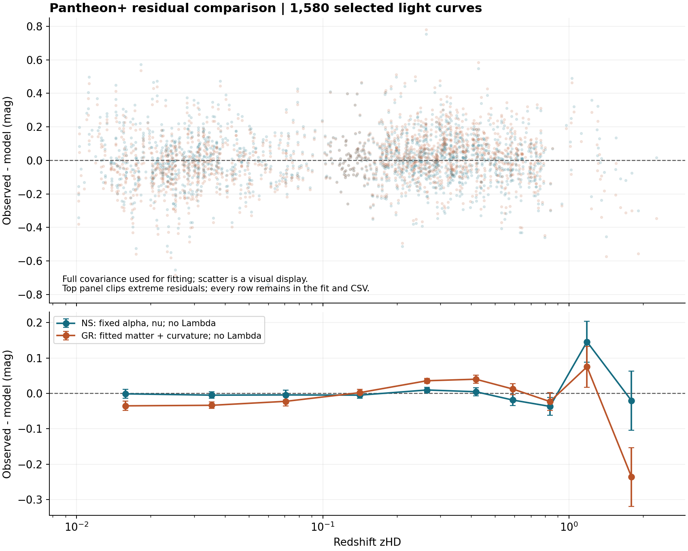

# 남승호법칙 Pantheon 잔차 비교 2026년 11월 1일

저자·제안자 남승호. 이 기록은 기존 남승호 고정 우주식의 전체 공분산 잔차 비교와 수치 재현 검산이다. 동일한 1,580개 관측행에서 우주상수 없는 물질·곡률 GR보다 남승호식의 잔차가 작았다.

| 모형 | 전체 공분산 χ² | 잔차 RMS |
|---|---:|---:|
| 남승호 고정식 | 1386.8169925791253 | 0.15339980444100576 mag |
| GR 물질과 곡률 Λ 없음 | 1434.6289313875345 | 0.1579579139107827 mag |

**Δχ² = NS − GR = −47.811938808409195.** 2026년 9월 27일 1,580행 기록을 반올림 범위에서 재현했다. 별도 1,701행 A 경로 저장표의 Δχ²=−39.790212와 표본·조건을 혼합하지 않는다. 이번 기록에 새 AIC/BIC 결과는 포함하지 않는다.

## 실행

저장소 루트에서 다음을 실행한다. 원자료는 공식 공개 주소에서 다운로드하고 저장 해시와 일치해야만 계산한다. 전체 공분산 파일은 약 33 MB다.

```bash
cd cosmology/2026-11-01-pantheon-residuals
python -m pip install -r requirements.txt
python download_data.py
OPENBLAS_NUM_THREADS=1 python compare_residuals.py
OPENBLAS_NUM_THREADS=1 python verify.py
```

`reference_results/`는 2026년 11월 1일 고정 결과다. `results/`는 재실행 출력이다. 구적 알고리즘 변경과 GR 경계의 해석식을 이용하는 별도 `verify.py`는 전체 공분산 χ²와 행별 잔차를 다시 대조한다. 재실행 전에 배포 파일은 `SHA256SUMS.txt`, 다운로드 원자료는 `input_sha256`으로 확인한다.

## 고정 계산 조건

- Pantheon+SH0ES 1,701행 중 `IS_CALIBRATOR == 0` 및 `zHD > 0.01`인 1,580행. 고유 CID는 1,466개이며 반복 관측행을 공분산과 함께 유지한다.
- 관측량은 `m_b_corr`. 모형별로 공통 밝기 기준점 하나만 프로파일한다. 절대 H0를 산출하지 않는다.
- 광도거리의 앞 계수에는 `1+zHEL`, 적분에는 `zHD`를 사용한다. χ²는 선택한 STAT+SYS 전체 공분산으로 계산한다.
- 남승호식은 `E²(z)=exp{α[(1+z)^ν−1]}`, `α=1.4835435161693789`, `ν=0.8263146605293827`. 이번에 두 계수를 재적합하지 않았다.
- GR 비교식은 `E²(z)=Ωm(1+z)³+(1−Ωm)(1+z)²`, 곡률거리 `S_k`를 포함한다. Ωm을 0~3에서 탐색하며 최적점은 하한 0 부근이다. 물질밀도의 정밀 측정이나 모든 GR 모형에 대한 판정이 아니다.

## 잔차 그래프와 봉인본



표시 구간은 시각화용이며 물리적 단계 수나 주기를 지정하지 않는다. 모든 관측행은 계산과 CSV에 포함한다. 구간별 오차는 모형 형태를 고정한 조건부 공분산이며 GR의 물질밀도 추정 불확도를 전파하지 않았다.

[DOCX 검증 봉인본](documents/NS_Pantheon_residual_verification_seal_20261101_R1.docx)

봉인은 대조 후 계산기록의 고정이다. 사전 예측 성공 인증이나 전자서명이 아니다. DOCX 메타데이터에는 기록 본문과 해시가 있으며, 문서 자체의 SHA256은 이 폴더의 배포 해시 목록에서 확인한다.

## 판정

| 단계 | 상태 | 범위 |
|---|---|---|
| 오픈데이터 | 완료 | 관측표와 전체 공분산 및 해시 |
| 공개값 대조 | 완료 | 고정식의 표본내 잔차 비교 |
| 수치 재현 | 완료 | 다른 적분 방식과 경계 해석식 |
| 이번 결과 기록 | 봉인 | 대조 후 계산기록 |
| 표적 제외 독립예측 | 미완 | 기존 계수의 Pantheon 입력 이력 |
| 사전 예측 봉인 | 미완 | 이번은 대조 후 기록 |
| 제3자 재현 | 미완 | 별도 재현자의 실행은 미확인 |

완전 무입력 독립예측은 불가능하다는 프로젝트 조건을 유지한다. 이번 잔차 개선만으로 원작용에서 α·ν를 직접 산출했다거나, 시간지연·영구 잔차의 인과적 기원을 검증했다고 주장하지 않는다.

## 출처

- [Pantheon+SH0ES 공식 공개자료](https://github.com/PantheonPlusSH0ES/DataRelease)
- [Brout 등 2022 Pantheon 우주론 분석](https://arxiv.org/abs/2202.04077)
- 프로젝트 기존 기준: 남승호법칙 ONLY ONE 무람다 중력총합 최신재작성 2026년 9월 27일 제7절.

원자료 제공자의 라이선스·인용 조건은 별도로 따른다. 프로젝트 코드와 보고서에는 저장소의 저작권 표시를 유지한다.
